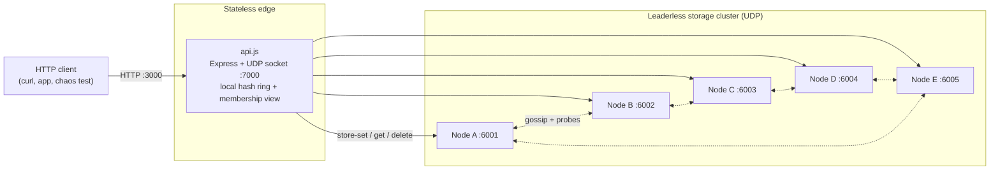
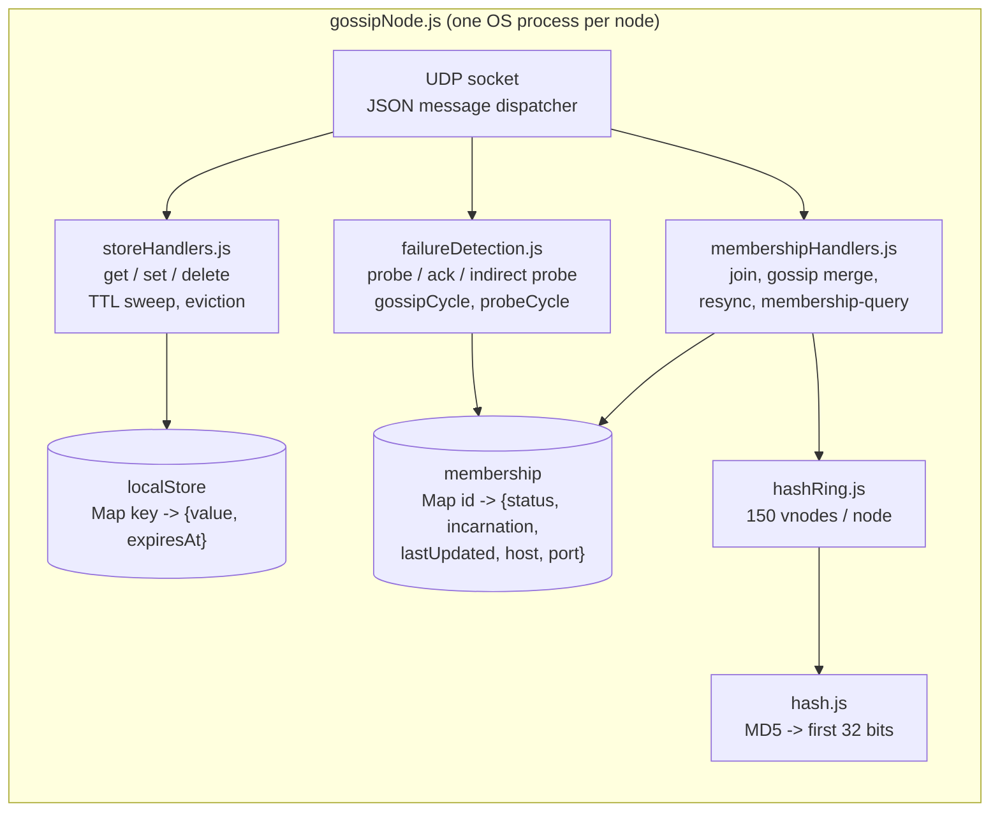
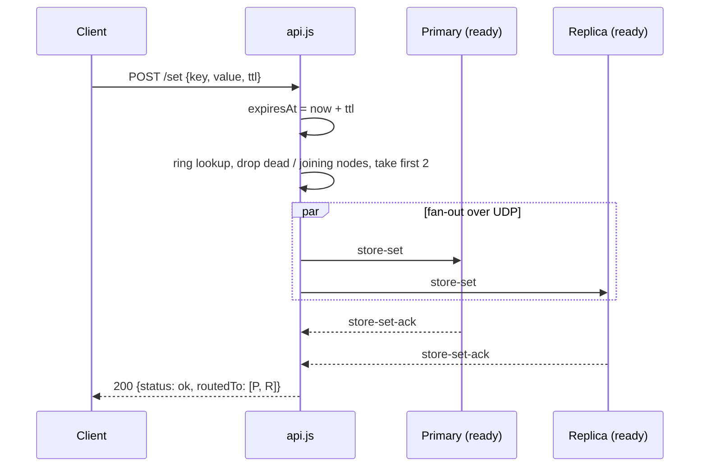
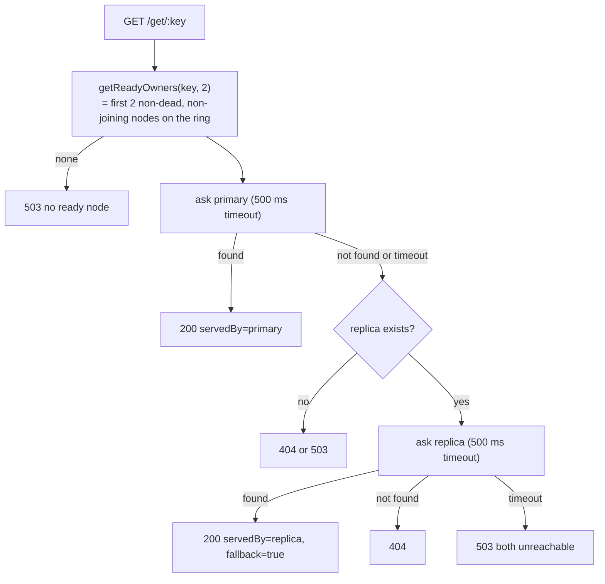
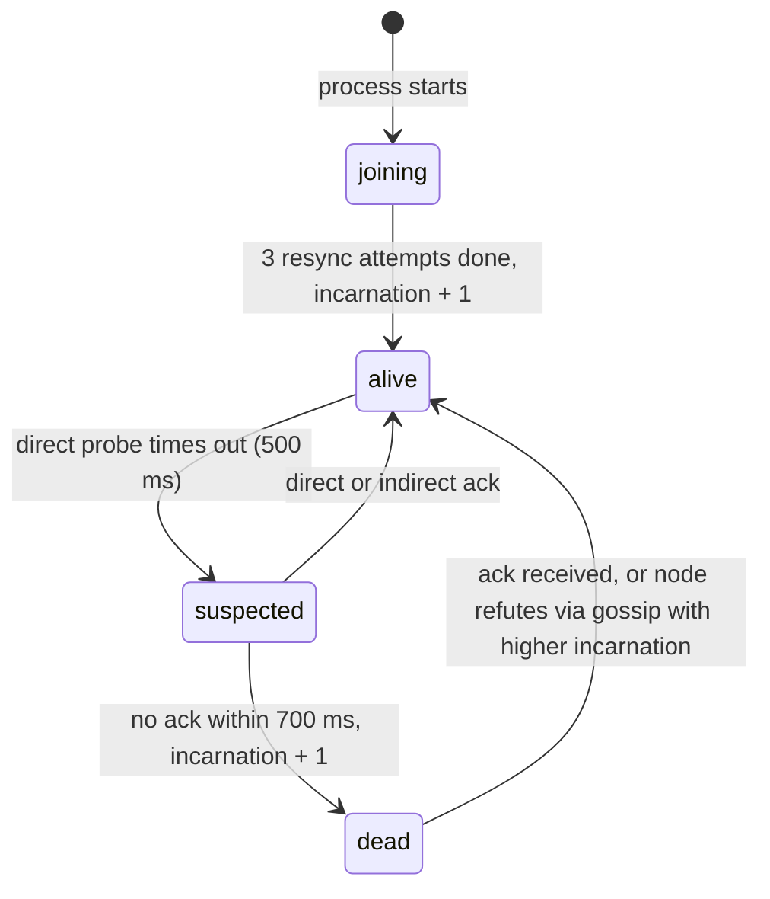
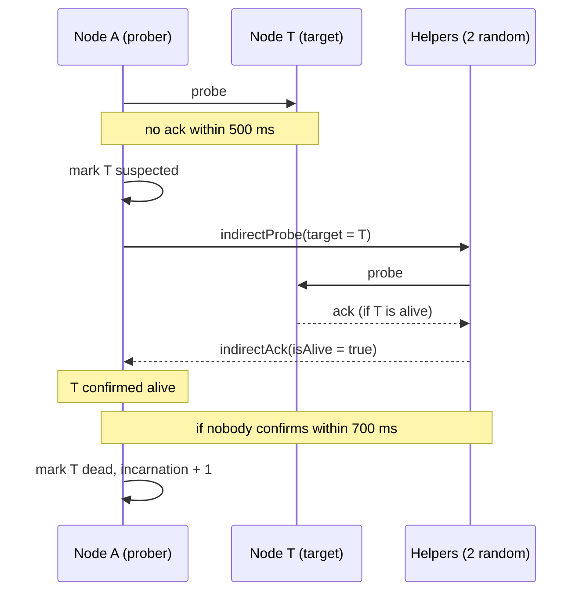

# Distributed Cache

> A from-scratch, UDP-based, distributed in-memory key/value cache in Node.js, built to learn how real distributed systems (Dynamo, Cassandra, Redis Cluster, memberlist/Consul) work under the hood.

  

This is **not** a production cache. It is a **system design learning project**: every major building block of a distributed data store is implemented by hand, in small readable files, with zero infrastructure dependencies beyond Node.js (Express is used only for the HTTP front door).

---

## Table of contents

1. [Goal of the project](#1-goal-of-the-project)
2. [What you get](#2-what-you-get)
3. [Quick start](#3-quick-start)
4. [Using the cache (HTTP API)](#4-using-the-cache-http-api)
5. [High-level architecture](#5-high-level-architecture)
6. [Deep dive: how each piece works](#6-deep-dive-how-each-piece-works)
7. [Wire protocol (UDP messages)](#7-wire-protocol-udp-messages)
8. [Design decisions and trade-offs](#8-design-decisions-and-trade-offs)
9. [Build it from scratch: a step-by-step path](#9-build-it-from-scratch-a-step-by-step-path)
10. [Experiments to run](#10-experiments-to-run)
11. [Configuration reference](#11-configuration-reference)
12. [Project layout](#12-project-layout)
13. [What we learned](#13-what-we-learned)
14. [Known limitations and bugs](#14-known-limitations-and-bugs)
15. [Roadmap](#15-roadmap)
16. [Troubleshooting](#16-troubleshooting)
17. [Further reading](#17-further-reading)

---

## 1. Goal of the project

Most engineers use distributed caches (Redis, Memcached, Cassandra) as black boxes. The goal here is to **open the box**: build a small cluster where we can kill nodes, add nodes, watch keys move, and see exactly *why* each design choice exists.

The questions this project answers by building rather than reading:

| Question | Where it is answered |
|---|---|
| How do I split data across N machines without reshuffling everything when N changes? | Consistent hashing with virtual nodes (`hashRing.js`) |
| How do I survive a machine dying without losing data? | Replication factor 2, replica fallback reads (`api.js`) |
| How do machines learn who else is in the cluster, with no central coordinator? | Gossip-based membership (`membershipHandlers.js`, `failureDetection.js`) |
| How do I detect failures without false alarms from one flaky link? | SWIM-style direct + indirect probing, suspicion, incarnation numbers (`failureDetection.js`) |
| How does a new node get its share of data? | Join protocol + resync + dual-writes during handoff |
| How do I bound memory? | Capacity eviction (LRU/LFU) and TTL expiry (`storeHandlers.js`) |
| How do I know it actually works under failure? | Chaos test that SIGKILLs a random node under load (`chaosTest.js`) |
| What is the difference between TCP and UDP in practice? | Standalone echo examples (`tcp*.js`, `udp*.js`) |

**Non-goals:** persistence, security, strong consistency, production performance.

---

## 2. What you get

- **Consistent hash ring** with 150 virtual nodes per physical node and MD5-based hashing.
- **Replicated storage**: each key lives on 2 nodes (primary + replica).
- **Leaderless peer-to-peer cluster**: every node runs the same code; no master.
- **Gossip membership**: nodes exchange their view of the cluster every second.
- **SWIM-style failure detection**: ping, indirect ping via helpers, suspected, dead, with incarnation numbers so a live node can refute false rumors.
- **Dynamic join**: start a 6th node at any time; it announces itself, pulls its data (resync), then goes live.
- **TTL** (absolute expiry timestamps, lazy + periodic cleanup) and **bounded memory** (max keys + eviction).
- **HTTP API** (`/set`, `/get/:key`, `/del/:key`) in front of the UDP cluster.
- **Docker Compose** for a 5-node cluster + API in one command.
- **Chaos test** that generates load, kills a node, and reports failure rates.

---

## 3. Quick start

### 3.1 Prerequisites

- Node.js **20+** and npm
- Docker Desktop with Compose (only for the container path)

### 3.2 Install

```sh
git clone <your-repo-url> distributed-cache
cd distributed-cache
npm install
```

> **Tip:** `package.json` currently lists `crypto`, `dgram` and `net` as dependencies. These are **built-in Node modules**; the npm packages with those names are deprecated placeholders. Only `express` is needed:
> ```sh
> npm uninstall crypto dgram net
> ```

### 3.3 Option A: run locally (5 terminals + 1)

Run from the repository root. Each node gets: `<id> <port> '<peers-json>'`.

```sh
# terminal 1
node node/gossipNode.js A 6001 '[{"id":"B","port":6002},{"id":"C","port":6003},{"id":"D","port":6004},{"id":"E","port":6005}]'
# terminal 2
node node/gossipNode.js B 6002 '[{"id":"A","port":6001},{"id":"C","port":6003},{"id":"D","port":6004},{"id":"E","port":6005}]'
# terminal 3
node node/gossipNode.js C 6003 '[{"id":"A","port":6001},{"id":"B","port":6002},{"id":"D","port":6004},{"id":"E","port":6005}]'
# terminal 4
node node/gossipNode.js D 6004 '[{"id":"A","port":6001},{"id":"B","port":6002},{"id":"C","port":6003},{"id":"E","port":6005}]'
# terminal 5
node node/gossipNode.js E 6005 '[{"id":"A","port":6001},{"id":"B","port":6002},{"id":"C","port":6003},{"id":"D","port":6004}]'
# terminal 6: the HTTP API
node api.js
```

**Wait about 10 seconds.** Each node starts in state `joining` and only flips to `alive` after its resync attempts finish (3 attempts, 3 s apart, then a 1 s grace). The API will not route to `joining` nodes. You will see `finished joining - now alive` in each node's log.

### 3.4 Option B: Docker Compose

```sh
docker compose up --build
```

This starts services `a`..`e` (gossip nodes) and `api` (published on `localhost:3000`). Stop with `Ctrl+C` or `docker compose down`.

> `docker-compose.yml` uses `build: .`, so the repository root needs a `Dockerfile`. If you do not have one, create it:
>
> ```dockerfile
> FROM node:20-alpine
> WORKDIR /app
> COPY package*.json ./
> RUN npm ci --omit=dev
> COPY . .
> ```
> (No `CMD` is needed; each service supplies its own `command`.)

### 3.5 Smoke test

```sh
curl -X POST http://localhost:3000/set -H "Content-Type: application/json" -d '{"key":"foo","value":"bar"}'
curl http://localhost:3000/get/foo
curl -X POST http://localhost:3000/set -H "Content-Type: application/json" -d '{"key":"session","value":"abc","ttl":5}'
curl -X DELETE http://localhost:3000/del/foo
```

Expected for the first `GET`: `{"status":"ok","key":"foo","value":"bar","servedBy":"C"}` (the serving node depends on where `foo` hashes).

---

## 4. Using the cache (HTTP API)

Base URL: `http://localhost:3000`

| Method | Path | Body | Description |
|---|---|---|---|
| `POST` | `/set` | `{ "key": string, "value": any, "ttl"?: seconds }` | Write to the 2 ready owners of `key` |
| `GET` | `/get/:key` | n/a | Read from the primary, fall back to the replica |
| `DELETE` | `/del/:key` | n/a | Delete from both owners |

### Responses

`POST /set`
```json
{ "status": "ok", "key": "foo", "value": "bar", "expiresAt": null, "routedTo": ["C", "A"] }
```
- `status` is `ok` if **at least one** owner acknowledged, else `failed`.
- `handoffTo` appears when one of the key's owners is still `joining` (it receives a best-effort extra copy, see [dual-write](#64-join-resync-and-handoff)).

`GET /get/:key`
- `200 { status:"ok", key, value, servedBy, fallback? }`: `fallback: true` means the primary did not answer or did not have the key and the replica served it.
- `404 { status:"not found" }`
- `503` if no ready node exists, or primary and replica are both unreachable.

`DELETE /del/:key` returns `{ status, key, routedTo }`.

---

## 5. High-level architecture

### 5.1 System context



Two planes:

- **Data plane**: `API -> owner nodes` for `store-set`, `store-get`, `store-delete`. The API is a *coordinator*: it hashes the key, picks the owners, fans out the request, and collapses the results into one HTTP response.
- **Control plane**: `node <-> node` gossip, probes, joins, resync. The API only *listens* here: every 3 s it asks one random node for its membership table (`membership-query`) to learn which nodes are `dead` or `joining`.

### 5.2 Inside a node



All nodes run **identical code**. State is entirely in memory and private to the process; the only shared "truth" is what converges through gossip.

### 5.3 Write path



### 5.4 Read path with failover



### 5.5 Node lifecycle (membership state machine)



### 5.6 Component responsibilities

| Component | Responsibility | State |
|---|---|---|
| `api.js` | HTTP front door, routing, replication fan-out, replica fallback, dual-write to joining nodes | Hash ring, cached membership view, in-flight request table |
| `gossipNode.js` | Process entry: parse CLI, build state, wire handlers, start timers | None of its own; owns the objects below |
| `storeHandlers.js` | Local KV operations, TTL, eviction | `localStore` |
| `membershipHandlers.js` | Join, gossip merge, resync, answering API membership queries | `membership`, `peers`, `ring` |
| `failureDetection.js` | Probes, indirect probes, gossip and probe timers, suspicion to dead | `pendingProbes` |
| `hashRing.js` / `hash.js` | Key to node mapping | Sorted array of `{point, nodeId}` |

---

## 6. Deep dive: how each piece works

### 6.1 Consistent hashing (`hashRing.js`, `hash.js`)

**Problem:** with `node = hash(key) % N`, going from 5 to 6 nodes remaps about 83% of keys, which would mean a cache stampede on every scale event.

**Solution:** hash both nodes and keys onto the same circular space (0 to 2^32-1). A key belongs to the first node point **clockwise** from its hash.

- `hashToInt(str)` = first 8 hex chars of `md5(str)` parsed as an integer (32-bit space).
- Each physical node is inserted **150 times** as virtual nodes: `hash("A#0")`, `hash("A#1")`, ... `hash("A#149")`. This smooths out the load: with few points per node, the ring segments are wildly uneven.
- `getNodeForKey(key, replicaCount)` binary-searches the sorted ring for the first point `>= hash(key)`, then walks clockwise collecting **distinct physical nodes** until it has `replicaCount`. (Despite the singular name it returns an **array** of node IDs: `[primary, replica, ...]`.)
- Adding a node moves only about `1/N` of the keys, and only *to* the new node.

Lookup is `O(log(N * vnodes))` via binary search.

### 6.2 Replication and request routing (`api.js`)

- **Replication factor = 2.** Owners of a key are the first two distinct nodes on the ring.
- `getReadyOwners(key, 2)` asks the ring for the **entire preference list** (all nodes, in ring order), filters out nodes the API believes are `dead` or `joining`, and takes the first 2. So if the primary is dead, the next node clockwise transparently *stands in*. (Nodes with no membership info yet are treated as ready.)
- **Writes** go to both ready owners in parallel (`Promise.allSettled`) and succeed if **any one** acks (effectively `W = 1`).
- **Reads** try the primary, then the replica (effectively `R = 1` with fallback).
- **Deletes** go to both owners.
- Each UDP round trip uses `sendAndWait` with a 500 ms timeout; replies are matched to requests through a `pendingRequests` map.

### 6.3 Gossip membership (`membershipHandlers.js`, `failureDetection.js`)

Every node keeps a `membership` map: `id -> { status, incarnation, lastUpdated, host, port }`.

- **Gossip cycle (every 1 s):** send the *entire* membership table to one random non-dead peer, plus, with 20% probability, to one random dead peer (so a recovered node gets re-integrated).
- **Merge rule (`handleGossip`):** accept an entry for node `X` if it is new, **or** has a higher `incarnation`, **or** has the same `incarnation` and a newer `lastUpdated`. This makes the merge order-independent and convergent.
- **Learning new nodes:** if gossip mentions an unknown node, add it to `peers` and to the local hash ring (`learnNewNode`). No central registry is needed: a new node only has to know **one** existing peer.
- **Epidemic spread:** information reaches all N nodes in roughly `O(log N)` gossip rounds.

### 6.4 Failure detection (SWIM-style, `failureDetection.js`)



- **Probe cycle (every 1 s):** A picks one random non-dead peer and sends `probe`; expects `ack` within 500 ms.
- **Indirect probing:** a single lost packet or one bad link must not condemn a healthy node. On timeout, A marks the target `suspected` and asks 2 other nodes to probe it on A's behalf. If any helper reports success, the target is alive again.
- **Incarnation numbers** are the key trick: they act as a logical clock owned by *the node itself*. When a node receives gossip saying *it* is `suspected` or `dead` at an incarnation `>=` its own, it bumps its incarnation and announces `alive`, which beats the rumor in the merge rule. This is how a falsely accused node **refutes** the accusation.
- When a probed node answers (`ack`) and was marked non-alive, it is flipped back to `alive`.

### 6.5 Join, resync and handoff (`membershipHandlers.js`, `api.js`)

When a new node starts (for example `F` in the README experiment):

1. It registers itself as `joining` and **announces** `join` to its seed peers.
2. Peers record it, add it to their rings (`learnNewNode`), and gossip spreads the news.
3. After 3 s, the new node sends `resync-request` to its peers, up to **3 times, 3 s apart**. Each peer replies with a **snapshot of its local store**.
4. For each key in a snapshot the new node adopts it only if (a) it has not expired and (b) the node itself is now one of the key's two owners according to its ring.
5. After the third attempt plus 1 s, the node sets itself `alive` with `incarnation + 1`, and gossip carries that to everyone.
6. The API, which polls membership every 3 s, now sees `alive` and begins routing to it.

**During the handoff window** (node `joining`), the API **dual-writes**: new writes for keys the joiner owns are *also* sent to it (fire-and-forget, not counted toward success), so it is not stale for the whole window.

### 6.6 Local store, TTL and eviction (`storeHandlers.js`)

- Each node has `Map<key, { value, expiresAt }>`.
- **TTL** is stored as an **absolute** `expiresAt` timestamp (computed at the API) so primary and replica agree on expiry regardless of when each received the write.
- Expiry is enforced two ways: **lazily** on read and by a **sweep every 2 s**.
- **Capacity:** default 50 keys per node. When a new key would exceed `maxKeys`, one victim is evicted. A `Map` iterates in insertion order, so re-inserting on access makes "first key" == least recently used. See [known issues](#14-known-limitations-and-bugs): the policy labels in the current code are swapped.

### 6.7 Transport: why UDP?

UDP is connectionless, cheap, and exactly what gossip and SWIM were designed for (HashiCorp's memberlist, Cassandra gossip, etc.). It also forces you to confront real distributed-systems problems: **lost packets, reordering, duplicates, timeouts, and request/response correlation**, which TCP would have hidden. The `tcpServer.js`/`tcpClient.js` and `udpServer.js`/`udpClient.js` files are minimal side-by-side examples used to learn the difference.

---

## 7. Wire protocol (UDP messages)

All messages are single JSON datagrams with a `type` field.

| `type` | Sender to receiver | Purpose | Key fields |
|---|---|---|---|
| `store-set` | API to node | Write a key | `key, value, expiresAt, fromPort, fromHost` |
| `store-set-ack` | node to API | Write confirmed | `key` |
| `store-get` | API to node | Read a key | `key, fromPort, fromHost` |
| `store-get-reply` | node to API | Read result | `key, value, found` |
| `store-delete` | API to node | Delete a key | `key, fromPort, fromHost` |
| `store-delete-ack` | node to API | Delete confirmed | `key, existed` |
| `membership-query` | API to node | Ask for a cluster view | `fromPort, fromHost` |
| `membership-reply` | node to API | Full membership table | `membership` |
| `join` | new node to peers | Announce presence | `id, port, host, status` |
| `gossip` | node to node | Share membership view | `from, gossip` |
| `probe` / `ack` | node to node | Liveness check | `from, fromPort, fromHost` |
| `indirectProbe` | node to helper | "Please probe `target` for me" | `target, targetPort, targetHost` |
| `indirectAck` | helper to prober | Result of the relayed probe | `target, isAlive` |
| `resync-request` | joiner to peers | Ask for data | `from, fromPort, fromHost` |
| `resync-response` | peer to joiner | Full local-store snapshot | `data` |

### Ports

| Process | UDP | HTTP |
|---|---|---|
| Node A..E | 6001..6005 | n/a |
| Dynamic node F (example) | 6006 | n/a |
| API | 7000 (reply socket) | 3000 |

---

## 8. Design decisions and trade-offs

| Decision | Why | What it costs |
|---|---|---|
| Consistent hashing + 150 vnodes | Minimal data movement on scale events; even load | A sorted array rebuilt on each add (fine at this scale) |
| Leaderless, symmetric nodes | No single point of failure, no election logic | No global ordering, so no strong consistency |
| Replication factor 2 | Survives one node failure | Two simultaneous failures of a key's owners lose it |
| `W = 1`, read-primary-then-replica | Availability and low latency | Stale reads and lost writes are possible; no conflict resolution |
| UDP + JSON | Simple, debuggable, matches gossip/SWIM tradition | Packet loss, 64 KB datagram limit, no auth, no framing |
| SWIM-style indirect probing | Far fewer false positives than ping-only | More messages; timing-based, so a slow node can look dead |
| Incarnation numbers | Lets a node refute false death rumors | Adds merge-rule complexity |
| Absolute TTL timestamps | Replicas expire a key at the same instant | Depends on roughly synchronized clocks |
| Full-snapshot resync | Trivial to implement | O(store size) bandwidth; large snapshots will not fit in one UDP packet |
| API keeps its own membership view | Keeps clients simple | Up to ~3 s staleness when routing |

In CAP terms the system leans **AP**: it prefers answering (possibly stale) over refusing, and offers **eventual** convergence rather than linearizability.

---

## 9. Build it from scratch: a step-by-step path

Follow these phases in order; each one is runnable and testable on its own and each introduces exactly one new distributed-systems idea.

### Phase 0: Project setup
```sh
mkdir distributed-cache && cd distributed-cache
npm init -y
npm i express
# set "type": "module" in package.json (the code uses ES modules)
mkdir node chaos test
```

### Phase 1: Learn the transports (`node/tcpServer.js`, `tcpClient.js`, `udpServer.js`, `udpClient.js`)
Write a TCP echo server and client, then a UDP receiver and sender. Observe: TCP gives a connection and reliable stream; UDP gives independent datagrams that may be lost. **Concept:** why gossip protocols choose UDP.

### Phase 2: Hash function and ring (`node/hash.js`, `node/hashRing.js`)
```js
// hash.js
import crypto from 'crypto';
export const hashToInt = s =>
  parseInt(crypto.createHash('md5').update(s).digest('hex').substring(0, 8), 16);
```
Implement `addNode`, `removeNode`, `hasNode`, and `getNodeForKey(key, replicaCount)` with a sorted array of `{point, nodeId}` and binary search. Experiment in `test/hashRing.test.js`: distribution evenness, effect of vnode count, and keys moved when a node is added (vs. naive modulo). **Concept:** consistent hashing.

### Phase 3: A single storage node (`node/storeHandlers.js`)
A `Map` plus UDP handlers for `store-set`, `store-get`, `store-delete`. Add `expiresAt` for TTL (check on read) and a periodic sweep. Add `maxKeys` and eviction. **Concept:** bounded memory, lazy vs. active expiry.

### Phase 4: HTTP API in front of one node (`api.js`)
Express routes `/set`, `/get/:key`, `/del/:key` that send UDP messages and await replies. Implement `sendAndWait(node, payload, timeout)` with a pending-request map. **Concept:** request/response over an unreliable transport (timeouts, correlation).

### Phase 5: Many nodes plus the ring in the API
Start 5 nodes with fixed ports; make the API route with the ring. **Concept:** partitioning (sharding).

### Phase 6: Replication and failover reads
Write to 2 owners; read primary, then replica. Kill a node by hand and watch reads fall back. **Concept:** replication, availability vs. consistency.

### Phase 7: Gossip membership (`node/gossipNode.js`, `membershipHandlers.js`)
Give each node a `membership` map; every second gossip it to a random peer; merge by `(incarnation, lastUpdated)`. **Concept:** epidemic dissemination, convergence without a coordinator.

### Phase 8: Failure detection (`node/failureDetection.js`)
Add `probe`/`ack`, then `indirectProbe`/`indirectAck`, then `suspected -> dead` with incarnation bumps and refutation. **Concept:** SWIM, false positives, why indirect probes matter.

### Phase 9: Let the API see membership
`membership-query` / `membership-reply`; API filters `dead` and `joining` nodes out of routing. **Concept:** failure-aware routing.

### Phase 10: Dynamic join (resync + dual-write)
`join` announce, `resync-request`/`resync-response`, `joining -> alive` transition, API dual-writes to joiners. **Concept:** rebalancing/handoff and consistency during topology change.

### Phase 11: Containerize
Write a `Dockerfile` and `docker-compose.yml` (one service per node, hostnames as peers, `HOST_*` env vars for the API). **Concept:** service discovery through DNS names; hosts vs. ports.

### Phase 12: Prove it with chaos (`chaos/chaosTest.js`)
Generate steady load, SIGKILL a random node mid-run, retry once, and report clean successes, retry-recoveries and permanent failures. **Concept:** testing distributed systems by injecting faults rather than only testing happy paths.

---

## 10. Experiments to run

1. **Failover:** start the cluster, `POST` a few keys, kill a node (`Ctrl+C` or `docker compose kill c`), and `GET` the keys. Watch `fallback: true` and the logs `marking suspected` then `marked DEAD`.
2. **Recovery:** restart the node. Watch it refute the dead rumor (`refuting false suspicion -- bumping own incarnation`) and come back.
3. **Scale out:** with the cluster running, start a sixth node:
   ```sh
   node node/gossipNode.js F 6006 '[{"id":"A","port":6001}]'
   ```
   Watch `learned of new node F via gossip`, `resync ... adopted N key(s)`, and `finished joining`. Check `handoffTo` in `/set` responses during the join window.
4. **Chaos run (spawns its own local cluster):**
   ```sh
   node chaos/chaosTest.js
   ```
   Against an already-running Docker cluster:
   ```sh
   SPAWN_CLUSTER=false node chaos/chaosTest.js
   ```
   The test waits 12 s for convergence, sends a request every 100 ms, kills a random node at +5 s, runs for 30 s, then prints totals and the permanent-failure rate. (Do not use the spawn mode while Docker already owns port 3000.)
5. **Hash ring benchmarks:**
   ```sh
   node test/hashRing.test.js
   ```
6. **Capacity and eviction:** start a node with a tiny capacity (`... localhost 3 lru`) and write more than 3 keys to its range.
7. **TTL:** `POST /set` with `"ttl":5`, then `GET` before and after 5 seconds.

---

## 11. Configuration reference

### Node process

```text
node node/gossipNode.js <id> <port> '<peers-json>' [host] [max-keys] [lru|lfu]
```

| Arg | Required | Default | Notes |
|---|---|---|---|
| `id` | yes | n/a | Unique node name, e.g. `A` |
| `port` | yes | n/a | UDP port to bind |
| `peers-json` | yes | n/a | `[{"id":"B","port":6002,"host":"b"}, ...]`; `host` is optional |
| `host` | no | `localhost` | This node's address as peers should reach it (service name in Docker) |
| `max-keys` | no | `50` | Max entries before eviction |
| `lru` / `lfu` | no | `lru` | Eviction policy (see known issues) |

### API process

| Env var | Default | Meaning |
|---|---|---|
| `HOST_A` .. `HOST_E` | `localhost` | Where each node is reachable |
| `API_HOST` | `localhost` | Address nodes use to send replies back to the API |

Hard-coded constants worth knowing (tune them to experiment):

| Constant | Value | File |
|---|---|---|
| Virtual nodes per node | 150 | `hashRing.js` / `api.js` |
| Replication factor | 2 | `api.js` |
| Gossip interval / probe interval | 1000 ms | `gossipNode.js` |
| Probe timeout | 500 ms | `failureDetection.js` |
| Indirect probe timeout / helpers | 700 ms / 2 | `failureDetection.js` |
| TTL sweep interval | 2000 ms | `gossipNode.js` |
| API request timeout | 500 ms | `api.js` |
| API membership refresh | 3000 ms | `api.js` |
| Resync attempts | 3, every 3 s | `membershipHandlers.js` |

---

## 12. Project layout

```text
.
├── api.js                      # HTTP API + routing + replication coordinator
├── docker-compose.yml          # 5 gossip nodes + API
├── Dockerfile                  # (create if missing, see section 3.4)
├── package.json
├── node/
│   ├── gossipNode.js           # Node entry point: CLI, state, wiring, timers
│   ├── membershipHandlers.js   # join, gossip merge, resync, membership-query
│   ├── failureDetection.js     # probes, indirect probes, gossip/probe cycles
│   ├── storeHandlers.js        # get/set/delete, TTL, eviction
│   ├── hashRing.js             # consistent hash ring with virtual nodes
│   ├── hash.js                 # md5 -> 32-bit integer
│   ├── tcpServer.js / tcpClient.js   # standalone TCP example
│   └── udpServer.js / udpClient.js   # standalone UDP example
├── chaos/
│   └── chaosTest.js            # load generator + random node kill
└── test/
    └── hashRing.test.js        # exploratory benchmarks (not an assertion suite yet)
```

---

## 13. What we learned

**Distribution and partitioning**
- Modulo sharding is a trap; consistent hashing keeps churn to about `1/N` of keys on a topology change.
- Virtual nodes are what make the ring *balanced*, and more vnodes means smoother distribution at the cost of memory.

**Replication and consistency**
- Replication buys availability but forces you to pick read/write semantics. With `W = 1` and `R = 1` you get speed and availability, and in exchange stale reads and diverging replicas.
- "Sloppy" stand-ins (the next node on the ring) keep writes flowing when an owner is down, but without hinted handoff the data is stranded there.

**Membership and failure detection**
- You cannot reliably tell "dead" from "slow" in an asynchronous network; every detector is a timing-based guess.
- Indirect probing and suspicion dramatically cut false positives.
- Incarnation numbers give each node the authority to refute rumors about itself.
- Gossip converges fast (about log N rounds) without any coordinator, but the cost is eventual, not instant, agreement.

**Unreliable networks**
- UDP surfaces everything TCP hides: loss, duplication, reordering, and the need to correlate replies to requests.
- Every network call needs a timeout, and every timeout needs a decision about what to do next.

**Topology changes are the hard part**
- A joining node must not serve reads until it has data (hence `joining` status), and writes during the handoff window must not be lost (hence dual-writes).

**Testing**
- Happy-path tests prove little. Killing nodes under load (chaos testing) quickly exposes timing bugs, request-correlation bugs, and slow failovers.

**Meta-lesson:** most of the complexity in a distributed system is not in the data structure, it is in the **edge cases of partial failure**.

---

## 14. Known limitations and bugs

This section is deliberately honest; each item is a good learning exercise.

### Correctness bugs worth fixing

1. **Eviction labels are swapped and `freq` is never initialised.** In `storeHandlers.js` the `lru` branch picks the *lowest frequency* (that is LFU), and the other branch picks the *oldest Map entry* (that is LRU). Also `handleStoreSet` stores `{ value, expiresAt }` with no `freq`, so `entry.freq += 1` becomes `NaN` and frequency comparisons never match. Fix: initialise `freq: 1` on set, make the frequency branch run for `lfu`, and the insertion-order branch for `lru`.
2. **Request correlation by `key + type` collides.** In `api.js`, pending requests are keyed as `key:replyType`. A write fans out to **two** nodes with the *same key*, so the second registration overwrites the first, one promise is never resolved and only rejects after the 500 ms timeout. Writes still report `ok` but are slower than necessary, and concurrent requests for the same key can steal each other's replies. Fix: add a unique `requestId` to every request and echo it in replies.
3. **Malformed UDP can crash a node.** `JSON.parse` in the `message` handlers (node and API) is not wrapped in `try/catch`; one bad datagram throws an uncaught exception and kills the process.
4. **Deletes can be resurrected.** There are no tombstones, so a later resync from a stale replica can bring a deleted key back.
5. **`getReadyOwners` has a stale comment** and the `ring.getNodeForKey(key, Object.keys(NODE_PORTS).length)` call is the way the full preference list is built; it is correct but worth refactoring into a clearly named `getPreferenceList`.

### Design limitations

- No quorum reads/writes, no versioning (no vector clocks or timestamps), so concurrent writes have no defined winner.
- No hinted handoff or anti-entropy (Merkle trees); data written to a stand-in node is not moved back when the owner returns.
- Resync sends the entire store in **one UDP datagram**, which will exceed ~64 KB with larger values or capacity and be silently dropped. Gossip also ships the whole membership table every time.
- Dead nodes are never removed from hash rings (they are only filtered at routing time), so rings grow monotonically.
- Nodes are not authenticated; anyone who can send a UDP packet can write, delete or inject membership.
- TTL relies on roughly synchronized wall clocks across hosts.
- Failure detection is timing-based and can mistake a slow or partitioned node for a failed one.
- The API starts with a fixed set `A..E` and learns extra nodes only from membership replies.
- Everything is in memory: restarting every node loses all data.

### Test debt

- `npm test` is a placeholder. `test/hashRing.test.js` is a script of benchmarks, and parts are stale: `getNodeForKey` now returns an **array**, so the distribution counters in `testEvenDistribution` and the comparison in `testMinimalReshuffling` need `[0]` (and `testMinimalReshuffling` re-adds node `E`, which already exists, instead of a new node like `F`).

---

## 15. Troubleshooting

| Symptom | Likely cause / fix |
|---|---|
| `503 no ready node for key` right after startup | Nodes are still `joining` (about 10 s). Wait until the logs show `now alive`. |
| `EADDRINUSE` on 3000, 7000 or 600x | A previous run or the Docker cluster is still using the port. Stop it, or use `SPAWN_CLUSTER=false` for the chaos test. |
| Docker build fails: "no Dockerfile" | Create one (see [section 3.4](#34-option-b-docker-compose)). |
| Nodes never see each other in Docker | Make sure each node's `host` argument (last argument in `docker-compose.yml`) matches its service name, and that peer JSON includes `host`. |
| API cannot reach nodes when running locally | Leave `HOST_*` and `API_HOST` unset (they default to `localhost`). |
| Writes feel slow (about 500 ms) | Known request-correlation issue, see [bug 2](#14-known-limitations-and-bugs). |
| A node crashes with a JSON `SyntaxError` | Something sent a non-JSON UDP packet, see [bug 3](#14-known-limitations-and-bugs). |
| `npm install` warns about deprecated `crypto`/`dgram`/`net` | Remove them, they are built in (see [section 3.2](#32-install)). |

---

## 17. Further reading

- **Dynamo: Amazon's Highly Available Key-value Store** (DeCandia et al., 2007): consistent hashing, sloppy quorums, hinted handoff
- **SWIM: Scalable Weakly-consistent Infection-style Process Group Membership Protocol** (Das, Gupta, Motivala, 2002)
- **Lifeguard** and HashiCorp **memberlist** docs: practical SWIM improvements
- **Karger et al., Consistent Hashing and Random Trees** (1997)
- **Designing Data-Intensive Applications** by Martin Kleppmann: chapters on replication, partitioning, and the trouble with distributed systems
- Cassandra and Redis Cluster architecture docs, for comparison with this implementation

---

*Built for learning. Break things, kill nodes, and read the logs.*
